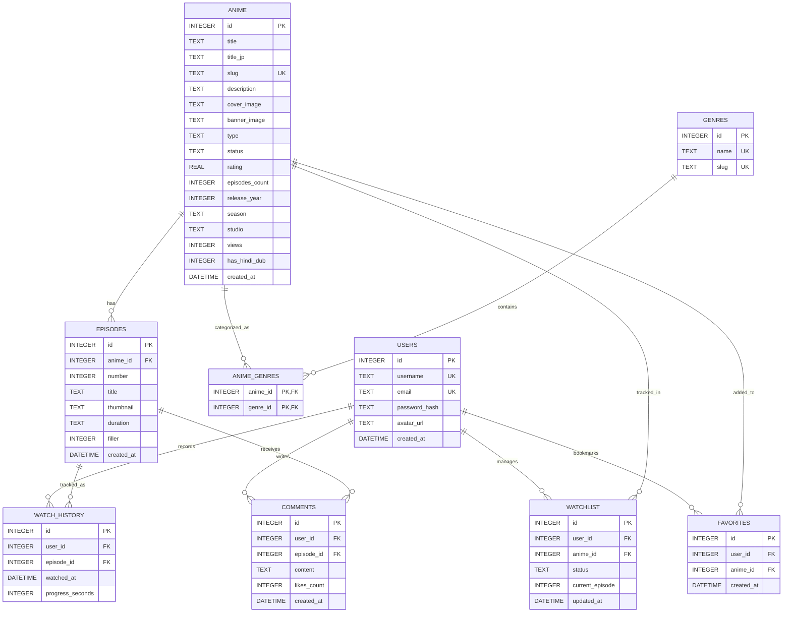

# 🗄️ Database Schema & Data Models - AnimeVault

> **Day 2 Deliverable | ALTA BUILDER 30 Challenge**  
> Engine: SQLite 3 (`better-sqlite3`) with WAL Mode and Foreign Key Constraints enabled.

---

## 1. Entity-Relationship (ER) Diagram



---

## 2. Table Specifications & Data Dictionaries

### 👤 `users`
Stores registered account credentials and profile details.
| Column | Type | Constraints | Description |
|---|---|---|---|
| `id` | `INTEGER` | PRIMARY KEY AUTOINCREMENT | Unique user identifier |
| `username` | `TEXT` | UNIQUE, NOT NULL | Display username for login/profile |
| `email` | `TEXT` | UNIQUE, NOT NULL | User email address |
| `password_hash` | `TEXT` | NOT NULL | Bcrypt hashed password string |
| `avatar_url` | `TEXT` | DEFAULT '/images/default-avatar.png' | Profile avatar path |
| `created_at` | `DATETIME` | DEFAULT CURRENT_TIMESTAMP | Registration timestamp |

---

### 🎬 `anime`
Core media entity storing title metadata, release details, and statistics.
| Column | Type | Constraints | Description |
|---|---|---|---|
| `id` | `INTEGER` | PRIMARY KEY AUTOINCREMENT | Unique anime ID |
| `title` | `TEXT` | NOT NULL | English / Romanized title |
| `title_jp` | `TEXT` | NULL | Native Japanese title |
| `slug` | `TEXT` | UNIQUE, NOT NULL | URL-safe identifier (e.g. `jujutsu-kaisen`) |
| `description` | `TEXT` | NULL | Full synopsis / summary |
| `cover_image` | `TEXT` | NULL | Poster artwork URL |
| `banner_image`| `TEXT` | NULL | Wide backdrop hero image URL |
| `type` | `TEXT` | CHECK in ('TV','Movie','OVA','ONA','Special') | Format classification |
| `status` | `TEXT` | CHECK in ('Airing','Completed','Upcoming') | Release status |
| `rating` | `REAL` | DEFAULT 0 | Community score (0.0 to 10.0) |
| `episodes_count`| `INTEGER`| DEFAULT 0 | Total episodes released |
| `release_year`| `INTEGER`| NULL | Initial release year |
| `season` | `TEXT` | NULL | Season of release (e.g. 'Fall 2024') |
| `studio` | `TEXT` | NULL | Animation production studio |
| `duration` | `TEXT` | DEFAULT '24 min' | Average runtime per episode |
| `views` | `INTEGER`| DEFAULT 0 | Popularity counter |
| `has_hindi_dub`| `INTEGER`| DEFAULT 0 | 1 if Hindi audio is available |
| `created_at` | `DATETIME`| DEFAULT CURRENT_TIMESTAMP | Record created timestamp |

---

### 🏷️ `genres` & `anime_genres` (Many-to-Many)
Taxonomy structure allowing anime to map to multiple genres (Action, Shonen, Fantasy, Romance, etc.).
- **`genres`**: `id` (PK), `name` (UNIQUE), `slug` (UNIQUE).
- **`anime_genres`**: Composite PK `(anime_id, genre_id)` with `ON DELETE CASCADE` on both foreign keys.

---

### 📺 `episodes`
Individual episode streams associated with an anime title.
| Column | Type | Constraints | Description |
|---|---|---|---|
| `id` | `INTEGER` | PRIMARY KEY AUTOINCREMENT | Unique episode ID |
| `anime_id` | `INTEGER` | FOREIGN KEY (anime.id) CASCADE | Parent anime reference |
| `number` | `INTEGER` | NOT NULL | Episode chronological number |
| `title` | `TEXT` | NULL | Episode title |
| `thumbnail` | `TEXT` | NULL | Episode preview thumbnail |
| `duration` | `TEXT` | DEFAULT '24 min' | Episode length |
| `filler` | `INTEGER` | DEFAULT 0 | 1 if filler episode, 0 if canon |
| `created_at` | `DATETIME` | DEFAULT CURRENT_TIMESTAMP | Creation timestamp |

---

### 📚 User Library: `watchlist`, `favorites`, `watch_history`
- **`watchlist`**: Tracks user's watch status (`watching`, `completed`, `plan_to_watch`, `dropped`, `on_hold`) and `current_episode`. Unique per `(user_id, anime_id)`.
- **`favorites`**: Quick bookmarking system. Unique per `(user_id, anime_id)`.
- **`watch_history`**: Tracks exact timestamp and playback position (`progress_seconds`) per `(user_id, episode_id)`.

---

## 3. Database Indexes for Query Optimization

```sql
CREATE INDEX idx_anime_slug ON anime(slug);
CREATE INDEX idx_anime_status ON anime(status);
CREATE INDEX idx_anime_type ON anime(type);
CREATE INDEX idx_anime_rating ON anime(rating);
CREATE INDEX idx_episodes_anime ON episodes(anime_id);
CREATE UNIQUE INDEX idx_episodes_anime_number ON episodes(anime_id, number);
CREATE INDEX idx_watchlist_user ON watchlist(user_id);
CREATE UNIQUE INDEX idx_watch_history_user_ep ON watch_history(user_id, episode_id);
CREATE INDEX idx_favorites_user ON favorites(user_id);
```
